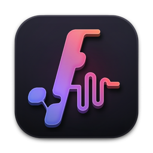
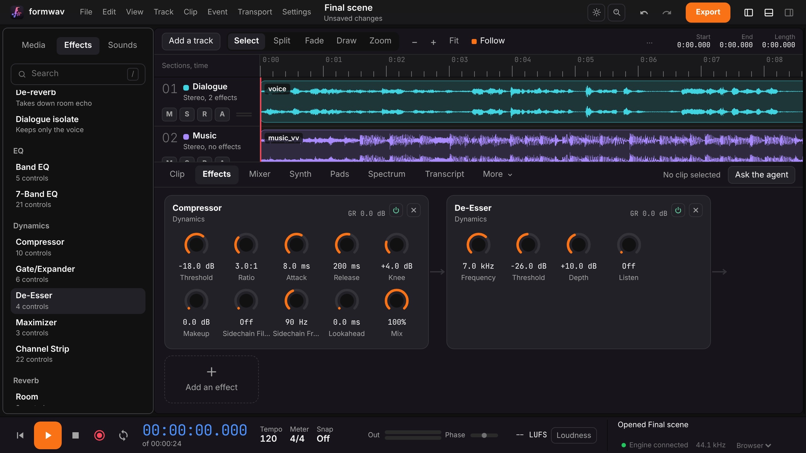
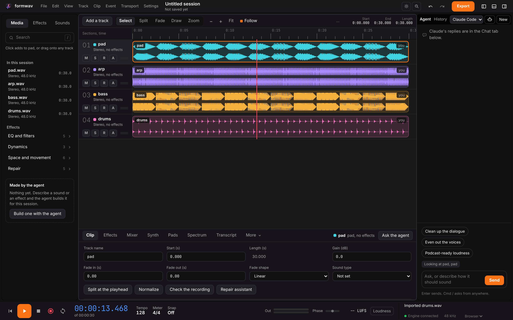
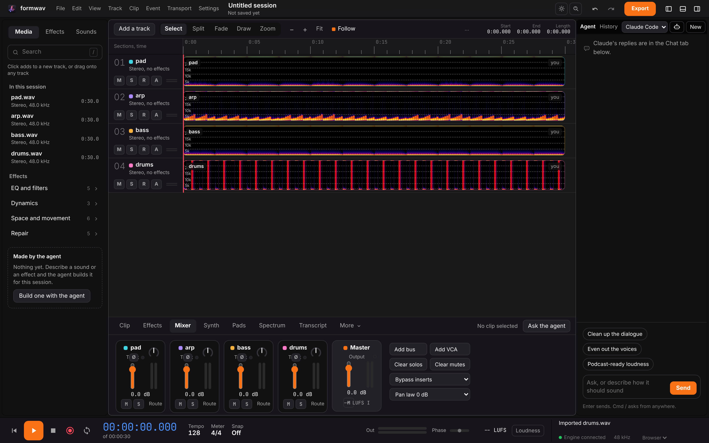

<p align="center">
  
</p>

<h1 align="center">FormWav</h1>

<p align="center">
  <b>Audio editing and music; the multitrack studio of the Form family.</b><br>
  Record, edit, repair, mix and export on your own machine,<br>
  with no account, no upload and no usage meter. Claude Code works inside it over MCP.
</p>

<p align="center">
  
  
  
  
  
  
  
</p>

<p align="center">
  <a href="https://formwav.formai.studio/"><b>Download FormWav on formai.studio</b></a> ·
  <a href="#run-it-from-source">Run it from source</a> ·
  <a href="#the-form-family">All Form apps</a>
</p>

<p align="center">
  
  <br>
  <sub>A dialogue and music scene with a compressor and de-esser chain on the voice track.</sub>
</p>

<p align="center">
  <a href="#features">Features</a> ·
  <a href="#everything-in-the-box">In the box</a> ·
  <a href="#built-for-agents">Agents</a> ·
  <a href="#under-the-hood">Under the hood</a> ·
  <a href="#download">Download</a> ·
  <a href="#run-it-from-source">Run from source</a> ·
  <a href="#the-form-family">Form family</a>
</p>

<table>
  <tr>
    <td width="25%" valign="top">
      <h3>Multitrack editing</h3>
      Cut, trim, fade, comp takes and move clips in four edit modes, with every edit one undo step.
    </td>
    <td width="25%" valign="top">
      <h3>Repair and mix</h3>
      De-hum, de-click, de-reverb and spectrogram healing, then sends, buses, VCAs and automation in a full mixer.
    </td>
    <td width="25%" valign="top">
      <h3>One core, two places</h3>
      The same Rust core mixes in the browser and renders exports in the engine, so what plays is what exports.
    </td>
    <td width="25%" valign="top">
      <h3>Agent-ready</h3>
      The window, a command line and an MCP server all run the same registry of commands on the open session.
    </td>
  </tr>
</table>

## Features

<table>
  <tr>
    <td width="50%" valign="top">
      
      <br><sub>A selected clip and its settings in the Clip tab.</sub>
      <h3>Clips you can shape</h3>
      Set gain, fades and their curve, split at the playhead, normalize, or run the repair assistant on a clip.
    </td>
    <td width="50%" valign="top">
      
      <br><sub>The same four stems as spectrograms.</sub>
      <h3>See the sound</h3>
      Switch clips to spectrograms, select a box, lasso or brush stroke of sound, and heal it in one undo step.
    </td>
  </tr>
</table>

## Everything in the box

<table>
  <tr>
    <td width="33%" valign="top">
      <h4>157 offline effects</h4>
      EQ and filters · Dynamics · Space and movement · Repair
    </td>
    <td width="33%" valign="top">
      <h4>Live processing</h4>
      19 realtime effects · 24 studio processors · Sends, buses and VCAs · Automation lanes · Loudness meters
    </td>
    <td width="33%" valign="top">
      <h4>Formats</h4>
      Opens: WAV · AIFF · FLAC · MP3 · M4A · OGG · Opus · a video's audio · MIDI · OMF · Saves: 12 export formats · Native: <code>.fmw</code>
    </td>
  </tr>
</table>

## Built for agents

One registry of 141 commands, the menu bar's items and the session tools. The window, the command line and the MCP server call the same ones.

```sh
./formwav cli list                    # every command on the open session
./formwav cli run <id> key=value      # run one command by id
```

`.mcp.json`, `.codex/config.toml` and `.cursor/mcp.json` are already wired in this repo. The engine also serves MCP at `http://127.0.0.1:8060/mcp`, and `backend/formwav_mcp/serve` runs a standalone stdio server. See [`AGENTS.md`](AGENTS.md).

## Under the hood

- **One mixer:** the Rust core (`native/formwav-dsp`) runs as WebAssembly in the browser and as a Python module in the engine.
- **Local first:** the interface and the engine bind 127.0.0.1; nothing listens on the network unless you turn it on.
- **26 languages:** English by default, with 25 more interface languages.

## Download

**Get the app:** download FormWav from [formai.studio](https://formwav.formai.studio/). That is the easiest way to install it.

**Releases:** [`nodemode-dev/formcompiler`](https://github.com/nodemode-dev/formcompiler/releases?q=formwav-v&expanded=true) (no FormWav release yet).

**Keep it updated:** [FormPortal](https://github.com/nodemode-dev/formportal) installs, updates and rolls back every Form app from the same signed catalogue.

| Platform | Target |
|---|---|
| macOS | Apple silicon |
| Linux and Windows | x64 (Linux also arm64) |

Not released yet. Run it from source below. All FormWav builds are compiled and released from FormCompiler, not from this repo. This repo holds the source.

## Run it from source

Prefer it in your browser, or want to contribute? Run the web UI straight from this repo.
**Requires:** Node 20.19 or newer, Python 3.12, Rust stable, git, and `ffmpeg` on your PATH. On Debian and Ubuntu add `libasound2-dev pkg-config`.

```sh
git clone git@github.com:nodemode-dev/formwav.git
cd formwav
./formwav_oc_install     # engine venv, audio core and interface
./formwav                # web UI at http://localhost:3060
```

On Windows use `formwav_oc_install.bat` and `formwav.bat`. Optional keys (`ANTHROPIC_API_KEY`, `ELEVENLABS_API_KEY`, `FAL_KEY`) go in `backend/.env`.

> **Status:** in development. The Windows scripts are written but not run on Windows, and the models run against stand-ins here; the reasoning and the gaps are kept in [`backend/HASHOUT_LOG.md`](backend/HASHOUT_LOG.md).

**Contributing:** branch from `main`, keep changes to source here, and leave packaging and releases to formcompiler. See [`AGENTS.md`](AGENTS.md).

## Repository

| Path | What it is |
|---|---|
| `backend/` | FastAPI engine, routes under `/api`, and the MCP server in `formwav_mcp/` |
| `frontend/` | Vanilla TypeScript and Vite interface |
| `native/` | Rust audio core (`formwav-dsp`) and the studio processors |

## The Form family

FormWav is one of the **Form apps**: native creative tools that install, update and roll back through FormPortal and can all be driven by agents.

| | App | What it's for | Download | Code |
|:-:|---|---|---|---|
|  | **form.md** | Documents, databases and realtime editing together | [formai.studio](https://formmd.formai.studio/) | [GitHub](https://github.com/nodemode-dev/form.md) |
|  | **FormAT** | Chat and agent workspace on your key | [formai.studio](https://format.formai.studio/) | [GitHub](https://github.com/nodemode-dev/format) |
|  | **FormCAD** | Drafting, parametric parts and NURBS surfaces | | [GitHub](https://github.com/nodemode-dev/formCAD) |
|  | **FormCel** | Spreadsheets agents can read and edit | [formai.studio](https://formcel.formai.studio/) | [GitHub](https://github.com/nodemode-dev/formcel) |
|  | **FormCraft** | Generate images, video, audio, 3D and worlds | | [GitHub](https://github.com/nodemode-dev/formcraft) |
|  | **FormCut** | Multi-track video editing with no upload | [formai.studio](https://formcut.formai.studio/) | [GitHub](https://github.com/nodemode-dev/formcut) |
|  | **FormDAM** | Photo library and asset manager | [formai.studio](https://formdam.formai.studio/) | [GitHub](https://github.com/nodemode-dev/formDAM) |
|  | **FormDeck** | Presentations and pitch decks | [formai.studio](https://formdeck.formai.studio/) | [GitHub](https://github.com/nodemode-dev/formdeck) |
|  | **FormDesign** | Page layout for print and the web | [formai.studio](https://formdesign.formai.studio/) | [GitHub](https://github.com/nodemode-dev/formdesign) |
|  | **FormEncoder** | Media encoding queue with presets | [formai.studio](https://formencoder.formai.studio/) | [GitHub](https://github.com/nodemode-dev/formencoder) |
|  | **FormFabric** | Sewing patterns draped with cloth simulation | | [GitHub](https://github.com/nodemode-dev/formfabric) |
|  | **FormLit** | Photo library and raw development | [formai.studio](https://formlit.formai.studio/) | [GitHub](https://github.com/nodemode-dev/formlit) |
|  | **FormMorpheus** | Frame-by-frame and performed animation | | [GitHub](https://github.com/nodemode-dev/formmorpheus) |
|  | **FormNET** | See what your computer sends online | | [GitHub](https://github.com/nodemode-dev/formNET) |
|  | **FormPath** | Vector illustration with artboards and type | [formai.studio](https://formpath.formai.studio/) | [GitHub](https://github.com/nodemode-dev/formpath) |
|  | **FormPDF** | Edit, redact, sign and fill PDFs | [formai.studio](https://formpdf.formai.studio/) | [GitHub](https://github.com/nodemode-dev/formpdf) |
|  | **FormPromo** | Promo films from your own media | [formai.studio](https://formpromo.formai.studio/) | [GitHub](https://github.com/nodemode-dev/formpromo) |
|  | **FormRef** | Reference boards for creative work | [formai.studio](https://formref.formai.studio/) | [GitHub](https://github.com/nodemode-dev/formref) |
|  | **FormRig** | Rig, skin and retarget any mesh | | [GitHub](https://github.com/nodemode-dev/formrig) |
|  | **FormSculpt** | 3D sculpting, remeshing and painting | [formai.studio](https://formsculpt.formai.studio/) | [GitHub](https://github.com/nodemode-dev/formsculpt) |
|  | **FormSurface** | Texture painting with PBR export | [formai.studio](https://formsurface.formai.studio/) | [GitHub](https://github.com/nodemode-dev/formsurface) |
|  | **FormTools** | Viewers, batch tools and file utilities | | [GitHub](https://github.com/nodemode-dev/formtools) |
|  | **FormTxt** | Word processing with .docx round trips | [formai.studio](https://formtxt.formai.studio/) | [GitHub](https://github.com/nodemode-dev/formtxt) |
|  | **FormVFX** | Motion graphics and VFX compositing | [formai.studio](https://formvfx.formai.studio/) | [GitHub](https://github.com/nodemode-dev/formvfx) |
|  | **FormVis** | Layered image editing with local AI | [formai.studio](https://formvis.formai.studio/) | [GitHub](https://github.com/nodemode-dev/formvis) |
|  | **FormWav** | Multitrack audio editing and mixing | [formai.studio](https://formwav.formai.studio/) | [GitHub](https://github.com/nodemode-dev/formwav) |
|  | **FormWeb** | Visual website building with a CMS | [formai.studio](https://formweb.formai.studio/) | [GitHub](https://github.com/nodemode-dev/formweb) |
|  | **FormPortal** | Install, update and roll back Form apps | [formai.studio](https://formportal.formai.studio/) | [GitHub](https://github.com/nodemode-dev/formportal) |
|  | **FormTray** | One dock icon for every app | [formai.studio](https://formtray.formai.studio/) | [GitHub](https://github.com/nodemode-dev/formtray) |
|  | **FormMCP** | One MCP connection to the family | [formai.studio](https://formmcp.formai.studio/) | [GitHub](https://github.com/nodemode-dev/formMCP) |
|  | **FormSkills** | Every app's agent skills in one place | [formai.studio](https://formskill.formai.studio/) | [GitHub](https://github.com/nodemode-dev/formskills) |
|  | **FormBench** | Parity, testing and rankings for the family | [formai.studio](https://formranker.formai.studio/) | [GitHub](https://github.com/nodemode-dev/formbench) |
|  | **FormSlot** | Codebase memory for coding agents | | [GitHub](https://github.com/nodemode-dev/formslot) |
|  | **SubForm** | Workbench for parallel Claude Code agents | | [GitHub](https://github.com/nodemode-dev/subform) |
|  | **FormCompiler** | Builds, signs and releases every app | [formai.studio](https://formcompiler.formai.studio/) | [GitHub](https://github.com/nodemode-dev/formcompiler) |
|  | **FormPipe** | Release pipeline and update feeds | | [GitHub](https://github.com/nodemode-dev/formpipe) |

---

## Maintainers

| Maintainer | Role |
|---|---|
| [@nodemode-ai](https://github.com/nodemode-ai) | Owner |
| [@gbarnai](https://github.com/gbarnai) | Co-owner |

Code owners are set in [`.github/CODEOWNERS`](.github/CODEOWNERS).

## License

FormWav is licensed under the Apache License 2.0 ([`LICENSE`](LICENSE), SPDX `Apache-2.0`). Copyright 2026 NodeAgentc, Inc. Third-party notices: [`NOTICE`](NOTICE), [`LICENSES.md`](LICENSES.md). Responsible use: [`USE_POLICY.md`](USE_POLICY.md).

<sub>Screenshot content: music stems made for the Form family, CC0.</sub>
