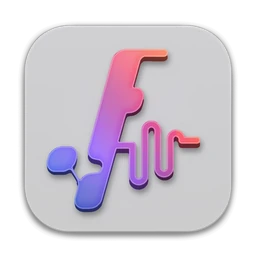
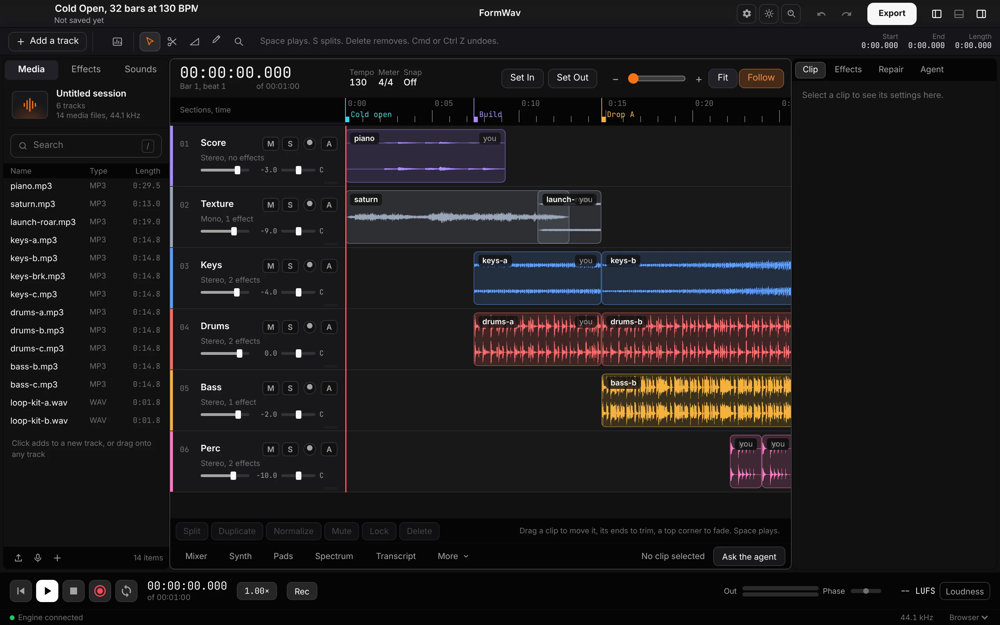
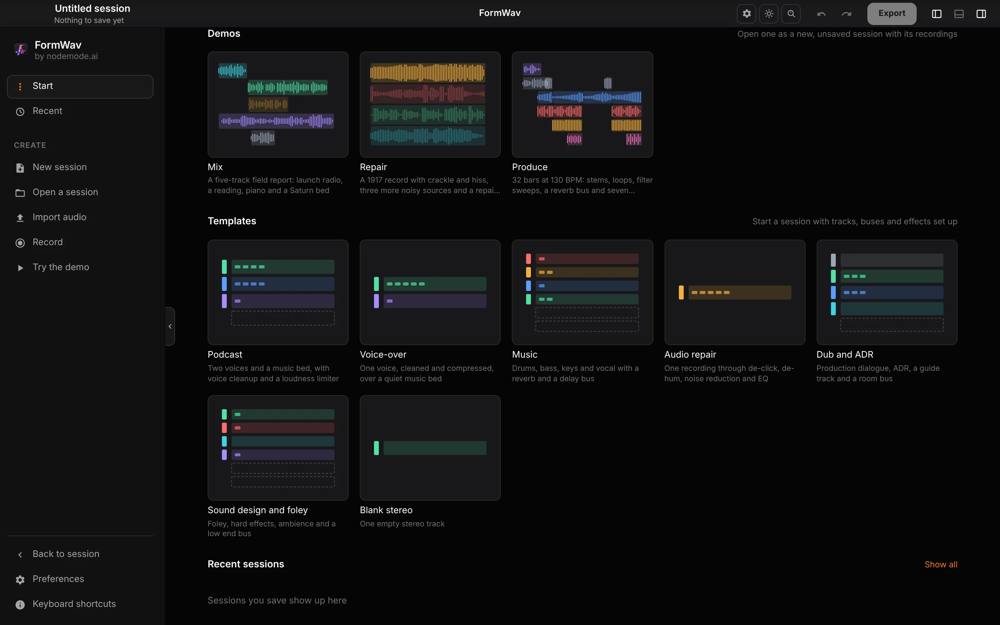
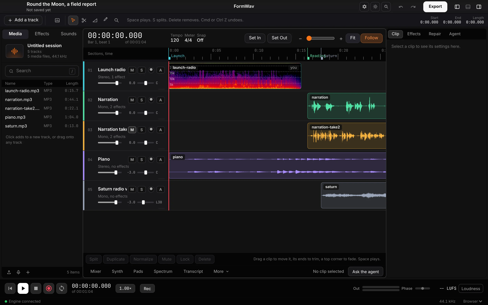
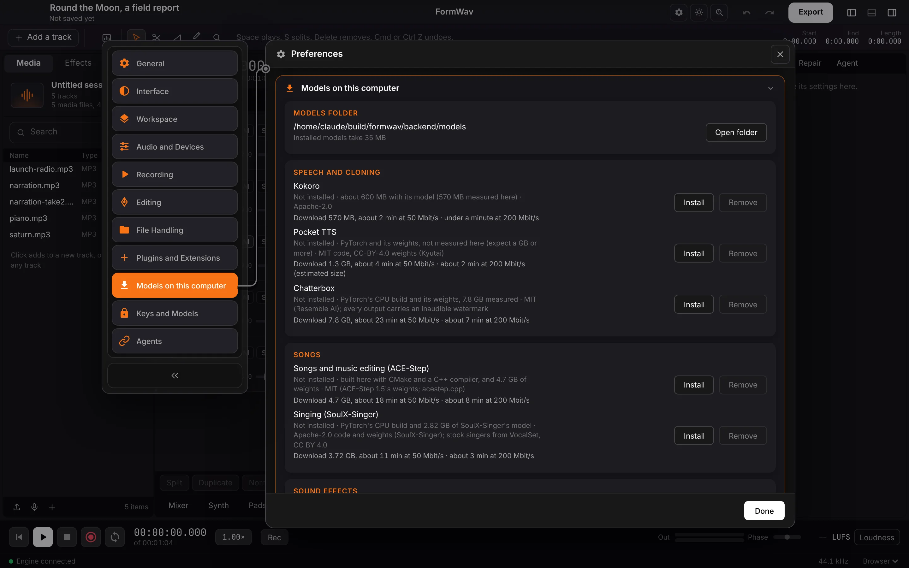
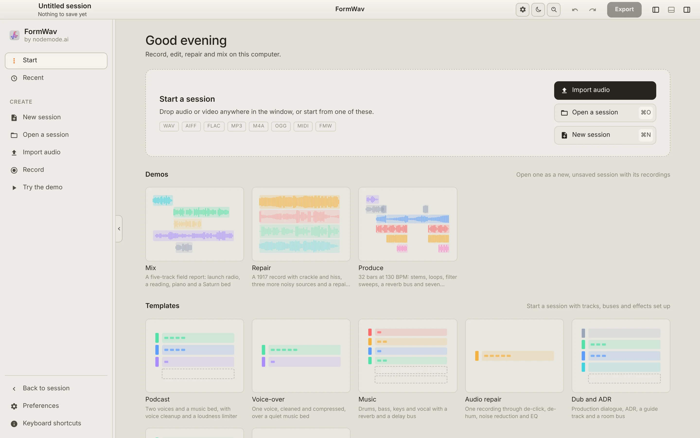

<p align="center">
  <picture>
    <source media="(prefers-color-scheme: dark)" srcset="assets/app-icon/formwav-256.png">
    
  </picture>
</p>

<h1 align="center">FormWav</h1>

<p align="center">
  <b>Audio editing and music; the multitrack studio of the Form family.</b><br>
  Record, edit, repair, mix and export on your own machine,<br>
  with no account, no upload and no usage meter. Claude Code works inside it over MCP.
</p>

<p align="center">
  
  
  
  
  
  
  
</p>

<p align="center">
  <a href="https://formwav.formai.studio/"><b>Download FormWav on formai.studio</b></a> ·
  <a href="#run-it-from-source">Run it from source</a>
</p>

<p align="center">
  
  <br>
  <sub>The Produce demo: 32 bars at 130 BPM with stems, loops and section markers.</sub>
</p>

<p align="center">
  <a href="#features">Features</a> ·
  <a href="#everything-in-the-box">In the box</a> ·
  <a href="#built-for-agents">Agents</a> ·
  <a href="#under-the-hood">Under the hood</a> ·
  <a href="#download">Download</a> ·
  <a href="#run-it-from-source">Run from source</a>
</p>

<table>
  <tr>
    <td width="25%" valign="top">
      <h3>Multitrack editing</h3>
      Cut, trim, fade, comp takes and move clips in four edit modes, with every edit one undo step.
    </td>
    <td width="25%" valign="top">
      <h3>Repair and mix</h3>
      De-hum, de-click, de-reverb and spectrogram healing, then sends, buses, VCAs and automation in a full mixer.
    </td>
    <td width="25%" valign="top">
      <h3>One core, two places</h3>
      The same Rust core mixes in the browser and renders exports in the engine, so what plays is what exports.
    </td>
    <td width="25%" valign="top">
      <h3>Agent-ready</h3>
      The window, a command line and an MCP server all run the same registry of commands on the open session.
    </td>
  </tr>
</table>

## Features

<table>
  <tr>
    <td width="50%" valign="top">
      
      <br><sub>Start: three demos and seven templates.</sub>
      <h3>Demos and templates on Start</h3>
      Open the Mix, Repair or Produce demo as a new unsaved session with its recordings, or start from a Podcast, Voice-over, Music, Audio repair, Dub and ADR, Sound design or Blank stereo template with its tracks, buses and effects set up. File > New from template and Help > Demos reach the same.
    </td>
    <td width="50%" valign="top">
      
      <br><sub>The Mix demo, with one clip shown as a spectrogram.</sub>
      <h3>Clips you can shape, sound you can see</h3>
      Set gain, fades and their curve, split at the playhead, normalize, or switch a clip to a spectrogram, select a box, lasso or brush stroke of sound, and heal it as a separate step.
    </td>
  </tr>
  <tr>
    <td width="50%" valign="top">
      
      <br><sub>Preferences, open at Models on this computer.</sub>
      <h3>Models you can size up first</h3>
      Every local model shows its download size and about how long it takes before you install it, then its progress and the space installed models take. API keys stay in the system password store, as in the rest of the Form family.
    </td>
    <td width="50%" valign="top">
      
      <br><sub>Start in the light theme.</sub>
      <h3>One window, light or dark</h3>
      On macOS the menus are the system menu bar's and the window never scrolls; the Start panel drags to any width. The page and its icon follow the light or dark theme, and so does the dock icon on macOS 26 and later.
    </td>
  </tr>
</table>

## Everything in the box

<table>
  <tr>
    <td width="33%" valign="top">
      <h4>157 offline effects</h4>
      EQ and filters · Dynamics · Space and movement · Repair
    </td>
    <td width="33%" valign="top">
      <h4>Live processing</h4>
      19 realtime effects · 24 studio processors · Sends, buses and VCAs · Automation lanes · Loudness meters
    </td>
    <td width="33%" valign="top">
      <h4>Formats</h4>
      Opens: WAV · AIFF · FLAC · MP3 · M4A · OGG · Opus · a video's audio · MIDI · OMF · Saves: 12 export formats · Native: <code>.fmw</code>
    </td>
  </tr>
</table>

## Built for agents

One registry of 141 commands, the menu bar's items and the session tools. The window, the command line and the MCP server call the same ones.

```sh
./formwav cli list                    # every command on the open session
./formwav cli run <id> key=value      # run one command by id
```

`.mcp.json`, `.codex/config.toml` and `.cursor/mcp.json` are already wired in this repo. The engine also serves MCP at `http://127.0.0.1:8060/mcp`, and `backend/formwav_mcp/serve` runs a standalone stdio server. See [`AGENTS.md`](AGENTS.md).

## Extensions

formwav loads extensions made to the Form Extension Contract: installed through FormPortal, or run from a folder while you make one with form.ext. They show in the **Extensions** menu (each extension's commands, Extensions panel, Reload extensions, Manage in FormPortal), in the Extensions panel under the editor's More (name, version, source, permissions, state), as panels in the editor or as dialogs, and in the command palette. Each runs in a sandboxed frame, reads and changes the session only through formwav's own commands (all of one call is one undo step), and asks before its first use. Agents reach them with `extensions_list` and `extension_command`, or `./formwav cli extensions`. What an extension can call is in [`docs/EXTENSIONS.md`](docs/EXTENSIONS.md).

## Under the hood

- **One mixer:** the Rust core (`native/formwav-dsp`) runs as WebAssembly in the browser and as a Python module in the engine.
- **Local first:** the interface and the engine bind 127.0.0.1; nothing listens on the network unless you turn it on.
- **26 languages:** English by default, with 25 more interface languages.

## Download

| Platform | Download | Release |
|---|---|---|
| macOS | [Download FormWav for macOS](https://formai.studio/get/formwav/macos) | [FormWav releases on FormCompiler](https://github.com/nodemode-dev/formcompiler/releases?q=formwav-v&expanded=true) |
| Windows | [Download FormWav for Windows](https://formai.studio/get/formwav/windows) | [FormWav releases on FormCompiler](https://github.com/nodemode-dev/formcompiler/releases?q=formwav-v&expanded=true) |
| Linux | [Download FormWav for Linux](https://formai.studio/get/formwav/linux) | [FormWav releases on FormCompiler](https://github.com/nodemode-dev/formcompiler/releases?q=formwav-v&expanded=true) |

All FormWav builds are compiled and released from [FormCompiler](https://github.com/nodemode-dev/formcompiler); this repo holds the source.

**Updates come through FormPortal.** FormWav does not update itself: install [FormPortal](https://formai.studio/formportal/) and it keeps FormWav up to date, or download the new version from the links above.

## Demo

Three offline demos open in a browser with no install, no engine and no network, each on real public-domain or CC0 audio or your own:

- [`demo/index.html`](demo/index.html), Mix: FormWav's waveform and spectrogram views and nineteen edits, including De-hum and Reduce noise repairs, on a five-track session of public-domain recordings (credits in [`demo/CREDITS.md`](demo/CREDITS.md); see [`demo/README.md`](demo/README.md)).
- [`demos/repair/index.html`](demos/repair/index.html), Repair: one noisy 1917 record on a live chain of Heal selection, De-click, De-hum, Reduce noise, EQ, a compressor and a loudness target, with a before and after A/B (see [`demos/repair/README.md`](demos/repair/README.md)).
- [`demos/produce/index.html`](demos/produce/index.html), Produce: a 32 bar piece at 130 BPM built from CC0 stems and one-shots with the step sequencer, effect chains, automation, markers and a bounce of the mix (see [`demos/produce/README.md`](demos/produce/README.md)).

## Run it from source

Prefer it in your browser, or want to contribute? Run the web UI straight from this repo.
**Requires:** Node 20.19 or newer, Python 3.12, Rust stable, git, and `ffmpeg` on your PATH. On Debian and Ubuntu add `libasound2-dev pkg-config`.

```sh
git clone git@github.com:nodemode-dev/formwav.git
cd formwav
./formwav_oc_install     # engine venv, audio core and interface
./formwav                # web UI at http://localhost:3060
```

On Windows use `formwav_oc_install.bat` and `formwav.bat`. Optional keys (`ANTHROPIC_API_KEY`, `ELEVENLABS_API_KEY`, `FAL_KEY`) are set in Preferences > Keys and Models, which keeps them in the system password store (a file only you can read where there is none); a key in `backend/.env` or the environment comes first, as in FormVis, and the row says so. Preferences > Models on this computer installs, removes and measures the models the engine runs here, shows each one's download size and about how long it takes before you install it, and opens their folder.

> **Status:** in development. The Windows scripts are written but not run on Windows, and the models run against stand-ins here; the reasoning and the gaps are kept in [`backend/HASHOUT_LOG.md`](backend/HASHOUT_LOG.md).

**Contributing:** branch from `main`, keep changes to source here, and leave packaging and releases to formcompiler. See [`CONTRIBUTING.md`](CONTRIBUTING.md), [`CODE_OF_CONDUCT.md`](CODE_OF_CONDUCT.md) and [`AGENTS.md`](AGENTS.md). Report security issues privately as [`SECURITY.md`](SECURITY.md) describes.

## Repository

| Path | What it is |
|---|---|
| `backend/` | FastAPI engine, routes under `/api`, and the MCP server in `formwav_mcp/` |
| `frontend/` | Vanilla TypeScript and Vite interface |
| `native/` | Rust audio core (`formwav-dsp`) and the studio processors |

---

## Maintainers

| Maintainer | Role |
|---|---|
| [@nodemode-ai](https://github.com/nodemode-ai) | Owner |
| [@gbarnai](https://github.com/gbarnai) | Co-owner |

Code owners are set in [`.github/CODEOWNERS`](.github/CODEOWNERS).

## License

FormWav is licensed under the Apache License 2.0 ([`LICENSE`](LICENSE), SPDX `Apache-2.0`). Copyright 2026 NodeAgentc, Inc. Third-party notices: [`NOTICE`](NOTICE), [`LICENSES.md`](LICENSES.md). Responsible use: [`USE_POLICY.md`](USE_POLICY.md).

<sub>Screenshot content: music stems made for the Form family, CC0.</sub>
